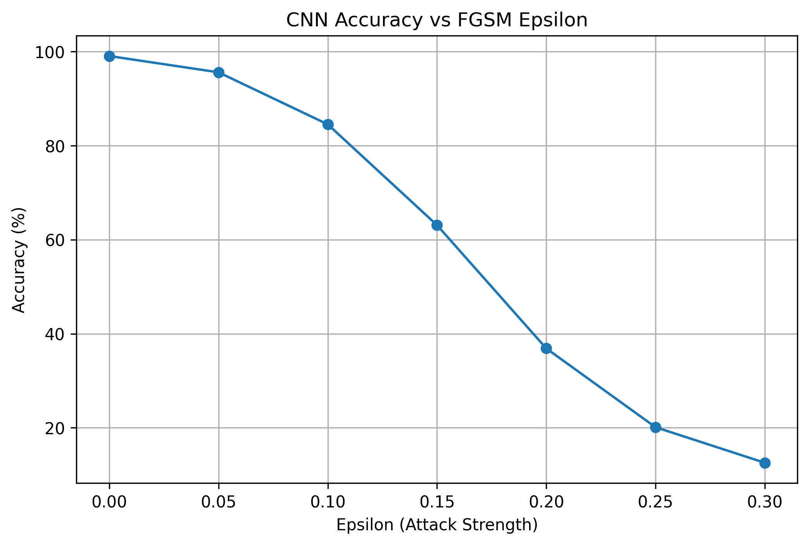
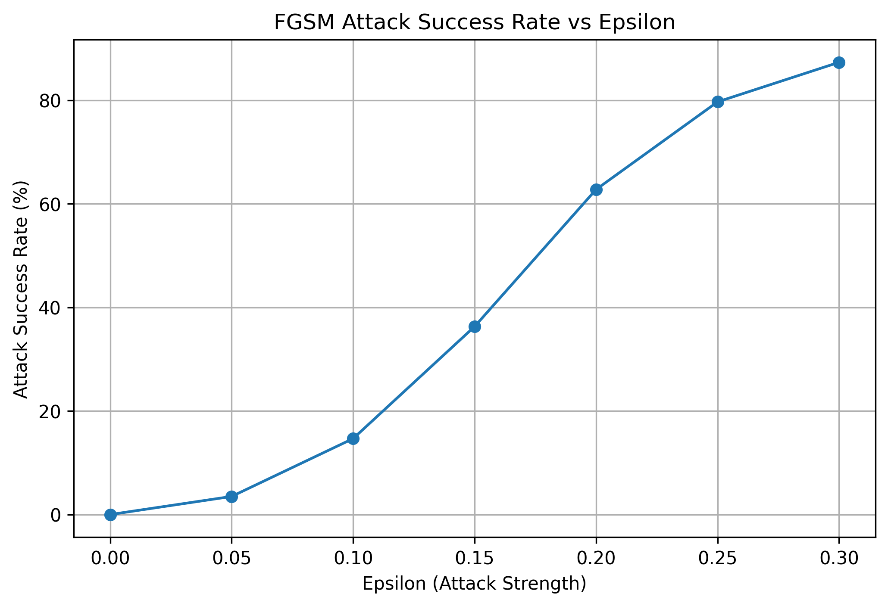

Auditing Neural Network Robustness via FGSM Adversarial Attacks

1. Project Overview

This project investigates the vulnerability of a Convolutional Neural Network (CNN) to adversarial attacks using the Fast Gradient Sign Method (FGSM).

The CNN is trained on the MNIST handwritten digit dataset. FGSM is then used to generate adversarial images by introducing small perturbations to the original inputs.

The objective is to evaluate how increasing attack strength affects the model's classification performance.

2. Technologies Used

- Python
- PyTorch
- Torchvision
- NumPy
- Pandas
- Matplotlib
- Google Colab

3. Dataset

MNIST Handwritten Digit Dataset

- Training images: 60,000
- Testing images: 10,000
- Image dimensions: 28 × 28 pixels
- Classes: 10 (digits 0–9)

4. Methodology

1. Load and preprocess the MNIST dataset.
2. Build a Convolutional Neural Network.
3. Train the CNN using the training dataset.
4. Evaluate its accuracy on clean test images.
5. Implement FGSM adversarial attacks.
6. Generate adversarial images using different epsilon values.
7. Evaluate accuracy and Attack Success Rate (ASR).
8. Visualize and analyze the experimental results.

5. Experimental Results

The CNN achieved 99.02% accuracy on clean test images.

Epsilon| Accuracy (%)| ASR (%)
0.00| 99.02| 0.00
0.05| 95.56| 3.49
0.10| 84.50| 14.66
0.15| 63.08| 36.30
0.20| 36.88| 62.75
0.25| 20.13| 79.67
0.30| 12.57| 87.31

### Accuracy vs FGSM Epsilon

### Attack Success Rate vs FGSM Epsilon

6. Key Findings

- The CNN achieved high accuracy on clean MNIST test images.
- Model accuracy decreased as epsilon increased.
- The FGSM attack became more successful with stronger perturbations.
- At epsilon = 0.30, the Attack Success Rate reached approximately 87.31%.

7. Project Files

File| Description
"FGSM_Adversarial_Robustness.ipynb"| Complete implementation
"fgsm_results.csv"| Experimental results
"fgsm_cnn_model.pth"| Trained CNN weights
"accuracy_vs_epsilon.png"| Accuracy graph
"asr_vs_epsilon.png"| ASR graph
"requirements.txt"| Required libraries
- The trained CNN model can be loaded using PyTorch without repeating the training process.

8. How to Run the Project

1. Clone this repository.
2. Install the required libraries using "pip install -r requirements.txt".
3. Open the Jupyter Notebook in Google Colab or Jupyter.
4. Run the notebook cells in order.
5. Load the saved model using the provided model-loading code in the notebook.

## Project Structure

FGSM-Adversarial-Robustness/
│
├── FGSM_Adversarial_Robustness.ipynb
├── fgsm_results.csv
├── fgsm_cnn_model.pth
├── accuracy_vs_epsilon.png
├── asr_vs_epsilon.png
├── requirements.txt
└── README.md

9. Conclusion

This project demonstrates that a neural network with high accuracy on clean data can still be vulnerable to adversarial attacks. It highlights the importance of evaluating model robustness alongside traditional classification accuracy.

10. Future Improvements

- Explore additional adversarial attack methods.
- Experiment with adversarial training.
- Compare different neural network architectures.
- Investigate robustness under different perturbation budgets.

---

Project Domain: Artificial Intelligence | Deep Learning | Adversarial Machine Learning
